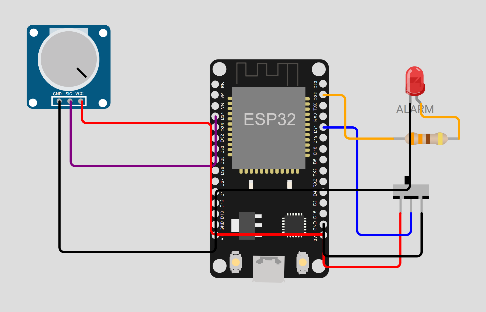
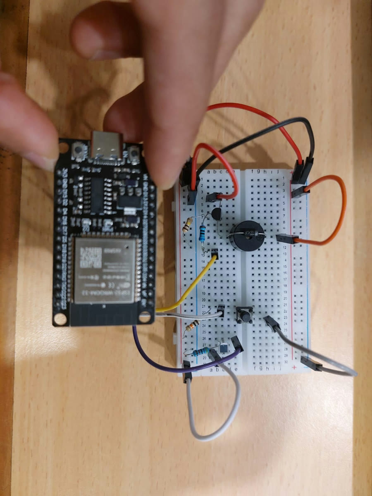
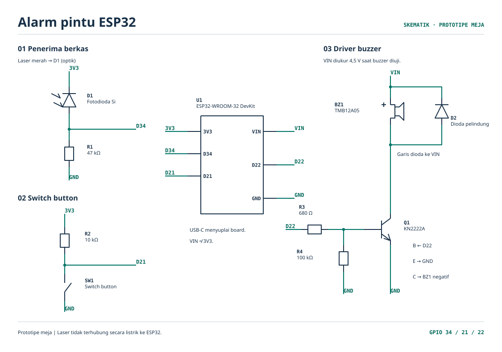

# Alarm Pintu ESP32 dengan Sensor Laser

**Berkas laser putus, buzzer menyala.** Buzzer tetap berbunyi meski berkas sudah kembali, sampai **switch button** dipencet.

Ini prototipe meja untuk tugas akhir. ESP32 membaca cahaya laser merah lewat fotodioda. Alur alarmnya juga bisa dicoba di Wokwi tanpa perangkat fisik.

[Coba simulasi Wokwi](#coba-di-wokwi) · [Lihat sambungan kabel](#sambungan) · [Buka skematik fisik](#lampiran-skematik-fisik)

*Simulasi Wokwi. Potensiometer mewakili sinyal fotodioda, sakelar geser mewakili switch button, dan LED merah mewakili buzzer.*

## Skematik, firmware, dan simulasi

| File | Untuk apa |
|---|---|
| [KiCad](hardware/kicad/door-alarm.kicad_sch) | Skematik fisik dengan simbol yang disertakan di dalam file. |
| [EasyEDA Standard](hardware/easyeda/door-alarm.json) | Impor lewat **File → Open → EasyEDA…**; hasilnya skematik yang bisa diedit. |
| [SVG](docs/diagrams/door-alarm.svg) | Gambar skematik untuk dibaca, dibesarkan, atau dimasukkan ke laporan. |
| [Wokwi](wokwi/) | Simulasi logika. Potensiometer menggantikan tegangan fotodioda; LED merah mewakili status buzzer. |
| [Sketch Arduino](firmware/DoorAlarm/DoorAlarm.ino) | Firmware ESP32 yang dipakai di prototipe meja. |
| [Catatan pengujian](docs/bench-tests.md) | Angka pengukuran, hasil uji, dan cara mengecek masalah wiring. |

Foto rangkaian meja

## Komponen

| Jumlah | Komponen | Fungsi |
|---:|---|---|
| 1 | ESP32 DevKit dengan modul ESP32-WROOM-32 | Membaca sensor dan switch button, lalu mengontrol buzzer. |
| 1 | Fotodioda silikon, dua kaki | Mengubah cahaya jadi arus. Tipe persis unit belum terkonfirmasi; BPW34 adalah contoh. |
| 1 | Pemancar laser merah terpisah | Memberi berkas ke fotodioda. Tidak disambungkan ke ESP32. |
| 1 | Switch button momentary | Menghubungkan GPIO21 ke GND saat dipencet. |
| 1 | Buzzer aktif `TMB12A05` | Menghasilkan bunyi saat mendapat daya DC. |
| 1 | Transistor NPN `KN2222A` | Menyambungkan sisi negatif buzzer ke GND saat GPIO22 aktif. |
| 1 | Dioda pelindung | Dipasang paralel dengan buzzer. Tipe persis unit belum terkonfirmasi; 1N5819 adalah contoh. |
| 4 | Resistor 47 kΩ, 10 kΩ, 680 Ω, dan 100 kΩ | Masing-masing satu. |
| 1 set | Breadboard, jumper, dan kabel USB-C data | Rangkaian meja, daya, dan upload. |

## Sambungan

**Cabut USB sebelum memindahkan kabel.** `VIN` dan `3V3` adalah jalur berbeda. Pada board yang diuji, `VIN` terbaca sekitar **4,5 V saat buzzer berbunyi**. Ukur sendiri pada board lain; jangan menganggap setiap DevKit meneruskan daya USB ke `VIN` dengan cara yang sama.

| Titik | Sambungan |
|---|---|
| **GPIO34 / `D34`** | Anoda fotodioda dan satu ujung **47 kΩ** bertemu di sini. Ujung resistor lain ke GND. Katoda fotodioda ke **3V3**. |
| **GPIO21 / `D21`** | Satu kontak switch button ke pin ini dan satu ujung **10 kΩ**. Ujung resistor lain ke **3V3**. Kontak switch button satunya ke GND. |
| **GPIO22 / `D22`** | Ke basis (`B`) `KN2222A` lewat **680 Ω**. Tambahkan **100 kΩ** dari basis ke GND. |
| **KN2222A** | Emitor (`E`) ke GND, kolektor (`C`) ke sisi negatif buzzer. Cek datasheet sebelum mengganti dengan transistor keluarga 2222 lain. |
| **Buzzer dan dioda** | Positif buzzer ke `VIN`. Dioda paralel: ujung bergaris ke **positif buzzer**, ujung tanpa garis ke **negatif buzzer**. |

## Upload dan coba

1. Instal **esp32 by Espressif Systems** di Boards Manager Arduino IDE. Jika perlu, gunakan [URL paket resmi](https://espressif.github.io/arduino-esp32/package_esp32_index.json).
2. Buka `firmware/DoorAlarm/DoorAlarm.ino`, pilih **ESP32 Dev Module** dan port USB board, lalu klik **Upload**.
3. Saat boot, buzzer diam sampai fotodioda melihat berkas yang stabil. Halangi berkas: buzzer harus bunyi dan tetap bunyi saat berkas kembali. Pencet switch button untuk membisukan. Jika berkas masih terhalang saat tombol dipencet, sistem menunggu berkas kembali sebelum siap lagi.

Ambang awal **1500 mV** diambil dari pembacaan satu rangkaian meja: **142 mV** saat berkas putus dan **3171 mV** saat berkas terdeteksi. Firmware meminta kondisi bertahan **10 ms** untuk berkas putus dan **60 ms** untuk berkas kembali. Itu durasi filter, bukan latensi total yang diukur.

### Coba di Wokwi

Buat [proyek ESP32 baru](https://wokwi.com/projects/new/esp32), lalu salin isi [`wokwi/sketch.ino`](wokwi/sketch.ino) dan [`wokwi/diagram.json`](wokwi/diagram.json) ke tab yang sesuai. Tekan **Start**. Biarkan potensiometer di posisi tinggi hingga ESP32 siap, lalu putar rendah untuk memicu alarm. Kembalikan potensiometer ke tinggi: LED harus tetap menyala. Geser sakelar virtual ke kanan untuk membisukan, lalu kembalikan ke kiri sebelum tes berikutnya. Saat sakelar mendapat fokus, tombol **Spasi** juga bisa mengubah posisinya.

Di Wokwi, sakelar virtual memberi level tinggi atau rendah ke GPIO21 dan sketch memakai pull-up internal. Rangkaian fisik tetap memakai switch button momentary dengan resistor 10 kΩ eksternal. Simulasi tidak mengukur optik laser, kepekaan fotodioda, tegangan `VIN`, atau kemampuan transistor menggerakkan buzzer fisik.

> **Batas penggunaan:** ini prototipe meja, belum diuji sebagai alarm pintu terpasang. Untuk demonstrasi dengan laser, gunakan pemancar yang kelas keselamatannya jelas dan penghalang berkas buram. Jangan gunakan laser tanpa label melintasi jalur orang.

## Lampiran: Skematik fisik

